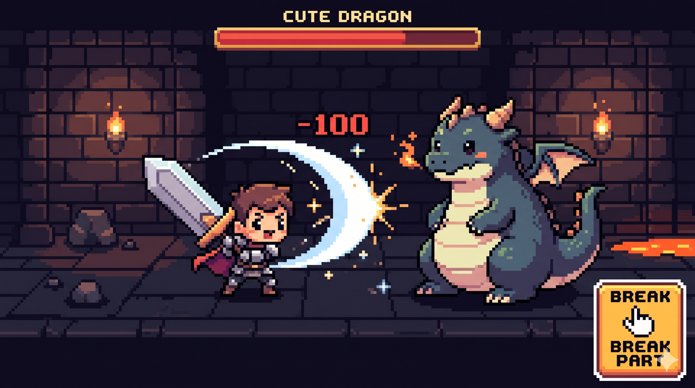
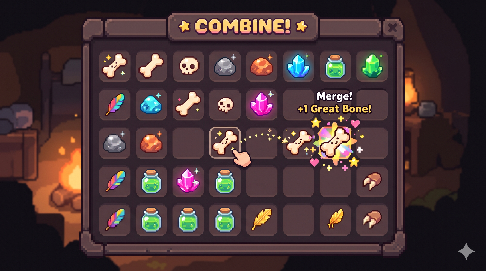
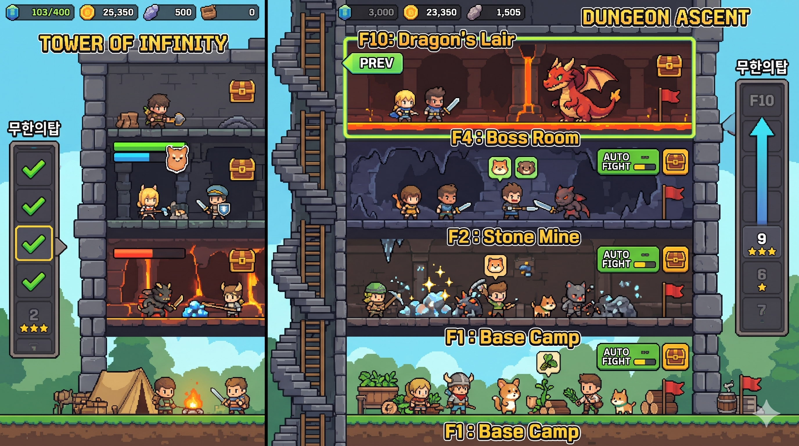

# 픽셀 헌터스 (Pixel Hunters) — 게임 기획서 v1

| 항목 | 내용 |
|---|---|
| 문서 버전 | v1.0 (2026-11-15) |
| 원본 | [`gdd.md`](gdd.md) (초안) + 컨셉 이미지 3장 |
| 장르 | 2D 도트 방치형 타워 크롤러 + 머지 크래프팅 RPG |
| 플랫폼 | 1차: 웹(HTML5, PC 브라우저) → 2차: Steam (Windows/Mac) → 3차: 모바일 가로모드 |
| 엔진 | Phaser + TypeScript + Vite (Steam은 Electron 래핑) |
| 한 줄 소개 | **동료가 탑을 캐고, 내가 합치고, 보스의 뿔을 부숴서 무기를 만든다.** |

> 수치는 모두 **초기 밸런스 값**입니다. 프로토타입을 플레이해 보면서 조정합니다. 수치와 데이터는 코드가 아니라 데이터 파일(JSON)로 관리해서, 요청 한 줄로 바꿀 수 있게 만듭니다.

---

## 0. 원본 검토 요약 (v1에서 바뀐 점)

| # | 원본의 문제 | v1 해결책 |
|---|---|---|
| 1 | 층마다 **1초에 1개** 생산 + 인벤토리 **20칸** → 동료 9명이면 2~3초 만에 가득 참. 오프라인 보상도 넣을 곳이 없음 | 생산된 아이템이 **층별 보관 상자**에 먼저 쌓이고, 그리드에 빈칸이 있을 때만 날아옴. 상자 용량이 곧 오프라인 보상 상한 (§4) |
| 2 | 문서는 5×4, 이미지는 8×5로 그리드 크기가 다름 | **8×4 그리드에서 5×4만 열린 상태로 시작**하고, 골드로 칸을 확장함 → 성장 요소로 활용 (§6) |
| 3 | 보스에게 지면 어떻게 되는지 정의 없음 | 헌터에게 HP가 있고, 쓰러지면 직전 층으로 후퇴. 자동 재도전 토글 (§5) |
| 4 | BREAK 버튼이 어느 부위인지 무관 → 몬스터헌터 느낌이 약함 | **약점 부위(뿔/발톱/갑각)가 표시**되고, 그 부위를 파괴하면 해당 소재가 드랍됨. 부위가 무기 레시피와 1:1로 연결 (§5.3) |
| 5 | 완성된 고티어 소재와 보스 소재가 그리드 칸을 계속 차지함 | **창고(보관함)** 추가: 아이템을 드래그해서 넣으면 수량으로 보관. 제작할 때 창고에서 차감 (§6.4) |
| 6 | 퀘스트, 동료 획득, 재화, 특성 트리가 정의되지 않음 | 의뢰 게시판(머지 아이템 납품) → 동료 획득. MVP 재화는 골드 하나. 특성 트리는 MVP 이후로 (§7, §8) |
| 7 | "1초마다 파밍"과 "드래그로 직접 합치기(손맛)"가 충돌함. 방치형인데 손이 못 따라감 | 생산 속도를 기본 **5초에 1개**로 낮춤. 생산이 막혀도 손해가 없도록 보관 상자가 버퍼 역할 |
| 8 | 좌측 탑 최상단과 우측 상단에 전투가 이중으로 표시됨 | 좌측 최상단은 **진행 표시(미니 뷰)**, 우측 상단이 **실제 전투 뷰**로 역할을 나눔 |
| 9 | 원본의 이미지 경로(camp.jpg 등)가 실제 파일명과 다름 | 아래 §10에서 실제 파일로 연결 |

---

### 0.1 프로토타입(v0.1) 구현 메모
기획서와 다르게 만든 부분입니다.

| 항목 | 프로토타입 구현 | 이유 |
|---|---|---|
| F1 베이스캠프 | 처음부터 열려 있고 견습 헌터가 약초를 캠. 전투는 F2부터 | 시작하자마자 합성판에 아이템이 들어오게 하려고 |
| 헌터 단련 (추가) | 골드로 공격력/체력 레벨업 (대장간 창) | 무기는 보스 소재가 필요해서, F2~F9 구간에 성장 수단이 없었음 |
| 엔진 버전 | Phaser 3.90 고정 | 최신 4.x는 API가 달라 검증된 3.x로 시작 |
| 포션 | 창고에 있으면 HP 30% 이하에서 자동 사용 (장착 단계 없음) | 단순화 |
| v0.2 추가 | 동료 레벨업, 상자 용량 업그레이드, 도감, 층 이벤트 말풍선, 의뢰 체크 표시, 무기 강화, 보스 부위 상태 표시 | §15 레퍼런스 적용 |
| v0.3 추가 | 몬스터 소재 드롭, 의뢰 추적기·강조, 합성 안내(드래그 대상/툴팁/튜토리얼/힌트), 콤보, 효과음 | §16 |
| 미구현 | 층당 동료 슬롯 확장, 배경음악, 특성 트리 | 다음 단계 |

---

## 1. 핵심 루프

```
 ┌─────────────────────────────────────────────────────────────┐
 │                                                             │
 ▼                                                             │
[동료 배치] ──(방치 생산)──▶ [층별 보관 상자] ──▶ [머지 그리드]    │
                                                  │ 드래그 합성  │
                                                  ▼             │
 [보스 전투] ──(BREAK 성공)──▶ [보스 부위 소재] ──▶ [창고]        │
     ▲                                             │            │
     │                                             ▼            │
 [층 돌파] ◀──(헌터 강해짐)── [무기 제작/강화] ◀─────┘            │
     │                                                          │
     └──(새 층 해금 = 새 주둔지 + 새 소재)───────────────────────┘
```

| 루프 | 주기 | 플레이어가 하는 일 |
|---|---|---|
| 초단위 | 1~10초 | 아이템 합치기, BREAK 타이밍 맞춰 클릭 |
| 분단위 | 1~10분 | 층 돌파, 의뢰 납품, 동료 배치 변경 |
| 시간단위 | 수 시간 | 접속해서 상자 비우기, 무기 제작, 보스 도전 |

---

## 2. 화면 구성 (3분할)

### 2.1 기준 해상도
- **내부 해상도 640×360**으로 그리고, 정수배로 확대합니다. ×2 = 1280×720, ×3 = 1920×1080.
- 확대할 때 보간 없음(nearest-neighbor)으로 처리해서 도트가 뭉개지지 않게 합니다.
- **가로(16:9) 전용.** 모바일도 가로모드로만 지원하고, 세로 레이아웃은 MVP 범위에서 제외합니다.

### 2.2 레이아웃 (640×360 기준 픽셀)

```
0                        240                                         640
┌──────────────────────────────────────────────────────────────────────┐ 0
│ 💰 골드 25,350   │ 📜 의뢰 2   │ ⚙ 설정            (상단 바, 높이 20)  │
├────────────────────────┬─────────────────────────────────────────────┤ 20
│ ▶ F10 최전선 (미니 뷰)  │                                             │
│────────────────────────│           ⚔ 전투 뷰 (400×180)                │
│ F9  🐱동료  ▓▓▓░░  📦12 │   헌터           보스 이름 / HP바            │
│ F8  🧔동료  ▓░░░░  📦 3 │    🗡     ✨-100      🐉   ◎약점            │
│ F7  (빈 자리)  [+배치]  │                                  [BREAK!]   │
│ F6  ...                ├─────────────────────────────────────────────┤ 200
│  ↕ 스크롤              │  머지 그리드 8×4 (칸 34px)       │ 📦 창고   │
│                        │  ┌──┬──┬──┬──┬──┬──┬──┬──┐       │ 🔨 제작   │
│  탑 영역 (240×340)      │  │  │  │  │  │  │🔒│🔒│🔒│       │ 💰 판매   │
│                        │  └──┴──┴──┴──┴──┴──┴──┴──┘       │ (128 폭)  │
└────────────────────────┴─────────────────────────────────────────────┘ 360
```

| 영역 | 크기 | 역할 |
|---|---|---|
| 상단 바 | 640×20 | 골드, 의뢰 알림, 설정 |
| 좌: 탑 | 240×340 | 최전선 미니 뷰 + 주둔지 층 목록(스크롤). 층마다 동료, 생산 게이지, 보관 상자 |
| 우상: 전투 | 400×180 | 헌터 vs 몬스터/보스, HP바, 데미지 숫자, BREAK 약점 |
| 우하: 머지 | 400×160 | 8×4 그리드(272×136) + 사이드 버튼(창고/제작/판매) |

### 2.3 도트 크기 가이드
| 대상 | 크기 |
|---|---|
| 아이템 아이콘 | 24×24 (34px 칸 안에) |
| 탑 안의 캐릭터 | 약 16×24 |
| 전투 뷰의 헌터 | 약 32×48 |
| 보스 | 약 96×96 (보스에 따라 다름) |
| 폰트 | 도트 폰트, 8px/16px 두 크기 (한글 지원 폰트 필요 — 예: Galmuri) |

---

## 3. 무한의 탑 (층 구조)

### 3.1 테마
| 층 | 테마 | 대표 소재 | 보스 (10층마다) |
|---|---|---|---|
| 1~10 | 숲 | 약초, 뼈, 가죽, 광석, 깃털 | F10 **새끼 녹룡** (컨셉 이미지의 드래곤) |
| 11~20 | 사막/광산 | 모래수정, 철광석, 전갈 껍질 | F20 미정 |
| 21~30 | 화산 | 불꽃 주머니, 흑요석 | F30 미정 |
| 31~ | 테마 순환 + 난이도 배수 | — | 강화된 보스 |

- **5층마다 정예 몬스터**(BREAK 없음), **10층마다 보스**(BREAK 있음).
- "무한"은 31층부터 테마를 다시 순환하고, 몬스터 HP와 공격력에 층수 배수를 곱해 구현합니다.

### 3.2 일반 층 진행
- 헌터가 몬스터 웨이브와 자동으로 싸웁니다. **10마리를 처치하면 층 클리어** → 주둔지가 해금되고 다음 층으로 올라갑니다.
- 헌터의 HP는 층 안에서 계속 유지됩니다. 포션이 장착되어 있으면 HP 30% 이하일 때 자동으로 사용합니다.
- 헌터가 쓰러지면 **직전 층으로 후퇴**합니다. "자동 재도전" 토글이 켜져 있으면 30초 후 다시 도전합니다.

---

## 4. 주둔지 & 방치 생산

### 4.1 생산 규칙
- 클리어한 층마다 **동료 슬롯 1개**가 있고, 최대 3개까지 확장할 수 있습니다.
- 각 층은 **고유 소재 라인**을 생산합니다. 동료 1명당 **기본 5초에 T1 아이템 1개**입니다.
- 생산된 아이템은 **층별 보관 상자**(기본 용량 20)에 먼저 들어갑니다.

### 4.2 아이템이 흐르는 방식
1. 머지 그리드에 빈칸이 있으면, 상자에서 아이템이 하나씩 그리드로 **날아갑니다**. 원본의 연출 그대로입니다.
2. 그리드가 가득 차면 아이템이 상자에 계속 쌓입니다.
3. 상자도 가득 차면 그 층의 **생산이 멈춥니다**. 상자 아이콘이 흔들리면서 플레이어에게 알려줍니다.
4. 상자를 클릭하면 빈칸만큼 한꺼번에 쏟아냅니다.

### 4.3 오프라인 보상
- 접속하지 않은 시간 동안 생산을 계산하되, **상자 용량을 넘지 않습니다.** 상자 용량이 곧 오프라인 상한이라 별도 시간 제한이 필요 없습니다.
- 재접속하면 "자리를 비운 동안 상자에 N개가 쌓였습니다" 팝업을 띄웁니다.
- 상자 용량 업그레이드(골드 사용)가 곧 오프라인 효율 업그레이드가 됩니다.

### 4.4 층별 생산 라인 (1~10층)
| 층 | 생산 라인 | 비고 |
|---|---|---|
| F1 베이스캠프 | 약초 | 대장간과 의뢰 게시판 위치 |
| F2 | 뼈 | |
| F3 | 가죽 | |
| F4 | 광석 | |
| F5 | (정예층) 깃털 | |
| F6~F9 | F2~F5 라인 반복 | 일정 확률로 **T2가 바로 생산**됨 (10%→25%) |

---

## 5. 전투 & 부위 파괴

### 5.1 기본 전투
- 자동 전투입니다. 헌터는 무기의 공격 주기마다 공격합니다.
- 데미지 = `헌터 공격력 × 무기 배수 × (치명타 시 2.0)`
- 몬스터와 보스도 주기적으로 공격합니다. 보스는 강공격 전에 **예고 모션(0.8초)** 을 보여줍니다.

### 5.2 보스 전투 흐름
1. 보스 등장 연출 → HP바와 이름 표시
2. 자동 전투 진행 중 **5~10초 간격(무작위)** 으로 약점이 등장
3. 헌터 HP가 0이 되면 후퇴. 보스 HP가 0이 되면 클리어 → 다음 테마 층 해금
4. 이미 잡은 보스는 F1 의뢰 게시판에서 **재도전**할 수 있습니다(파밍용).

### 5.3 BREAK — 부위 파괴 (핵심 수동 개입)
- 보스의 **특정 부위(뿔/발톱/갑각)** 에 깜빡이는 약점 마커가 뜨고, 동시에 우측 하단에 `BREAK!` 버튼이 나타납니다.
- 마커나 버튼 중 아무거나 클릭하면 성공입니다. PC에서는 **스페이스바**로도 됩니다.
- **입력 시간: 기본 1.5초**, 해머 장착 시 3.0초.

| 결과 | 효과 |
|---|---|
| 성공 | 치명 데미지(공격력 ×5) + 보스 **2초 스턴** + 해당 부위 **파괴 연출**(뿔이 부러진 스프라이트로 교체) + **해당 부위 소재 확정 드랍** |
| 실패 (놓침) | 페널티 없음. 다음 약점을 기다림 |

- 부위마다 **전투당 1회만** 파괴할 수 있습니다(보스당 최대 3개 소재). 3부위를 모두 부순 뒤의 약점은 치명 데미지만 줍니다.
- 어느 부위에 약점이 뜰지는 무작위입니다. 단, **아직 안 부순 부위가 우선**입니다.
- 보스 소재는 **머지로 만들 수 없고**, 드랍되면 창고로 바로 들어갑니다(그리드가 가득 차도 손실 없음).

### 5.4 F10 보스: 새끼 녹룡
| 부위 | 드랍 소재 | 쓰이는 곳 |
|---|---|---|
| 뿔 | 녹룡의 뿔 | 해머 |
| 발톱 | 녹룡의 발톱 | 쌍검 |
| 갑각(등비늘) | 녹룡의 갑각 | 대검 |

→ **어떤 부위를 노리느냐가 곧 어떤 무기를 만들 것인가**로 이어집니다.

---

## 6. 머지 인벤토리

### 6.1 그리드
- 전체 **8×4 = 32칸**이고, 시작할 때는 **5×4 = 20칸**만 열려 있습니다.
- 잠긴 칸은 골드로 해금합니다(가격은 칸마다 상승).

### 6.2 드래그 앤 드롭 규칙
아이템 A를 칸 B로 드래그했을 때:

| B의 상태 | 결과 |
|---|---|
| 빈칸 | 이동 |
| **같은 아이템, 같은 티어** | **합성** → 다음 티어 1개 (최대 티어면 자리만 바꿈) |
| 시크릿 레시피가 있는 조합 | **융합** → 특수 아이템 (도감 등록) |
| 그 외 | 두 아이템의 자리를 바꿈 |

- 일괄 합성 버튼은 **넣지 않습니다**(원본 의도대로 손맛 우선). 단, 손이 바쁜 후반을 위해 MVP 이후에 "자동 합성 동료"를 검토합니다.

### 6.3 소재 라인 (T1 → T4, 2개 → 1개)
| 라인 | T1 | T2 | T3 | T4 |
|---|---|---|---|---|
| 약초 | 풀잎 | 약초 다발 | 회복 포션 | 고급 포션 |
| 뼈 | 뼈조각 | 큰 뼈 (Great Bone) | 고대 해골 | 용골 |
| 가죽 | 가죽 조각 | 질긴 가죽 | 두꺼운 가죽 | 명품 가죽 |
| 광석 | 돌멩이 | 구리 광석 | 푸른 수정 | 빛나는 수정 |
| 깃털 | 깃털 | 황금 깃털 | 무지개 깃털 | 불사조 깃털 |

- T3 1개 = T1 4개. 무기 1개에 필요한 T3 5개 = **T1 20개**.
- 포션(약초 T3 이상)은 창고에서 헌터에게 장착해서 소비합니다. 약초 라인은 전투 지원용입니다.

### 6.4 창고 / 판매
- **창고**: 아이템을 사이드의 📦 버튼으로 드래그하면 수량 단위로 보관합니다(용량 무제한). 창고에서 다시 그리드로 꺼낼 수도 있습니다.
- **판매**: 💰 버튼으로 드래그하면 골드로 바뀝니다(티어가 높을수록 가치가 큼).

### 6.5 시크릿 융합 (도감)
- 서로 다른 특정 소재끼리 합치면 특수 아이템이 나옵니다. 레시피는 공개하지 않습니다.
- 처음 발견하면 도감에 등록되고 보상(골드)을 줍니다.
- 예시: `구리 광석 + 불꽃 주머니 → 홍련석`, `질긴 가죽 + 황금 깃털 → 바람 망토 천`
- MVP에서는 숲 소재끼리의 레시피 3개만 넣습니다.

---

## 7. 장비 제작

### 7.1 대장간 (F1 베이스캠프)
- 사이드의 🔨 버튼 → 제작 창이 열림 → 레시피 선택 → 창고에서 재료 차감 → 무기 획득
- 무기는 하나만 장착합니다. 언제든 교체할 수 있습니다.

### 7.2 무기 (1차: 숲 테마)
| 무기 | 공격 주기 | 데미지 배수 | 특성 | 레시피 |
|---|---|---|---|---|
| 낡은 검 (기본) | 1.0초 | ×1.0 | 없음 | 시작 장비 |
| **대검** | 2.0초 | ×2.6 | 공격 시 15% 확률로 **보스 강공격 캔슬(경직)** | 고대 해골 ×5 + 녹룡의 갑각 ×1 |
| **쌍검** | 0.35초 | ×0.4 | 치명타 확률 +20%, 타격마다 **출혈** 누적(초당 피해) | 두꺼운 가죽 ×5 + 녹룡의 발톱 ×1 |
| **해머** | 1.5초 | ×1.7 | 기절 게이지 누적, **BREAK 입력 시간 1.5초 → 3.0초** | 푸른 수정 ×5 + 녹룡의 뿔 ×1 |

> 원본의 "공속 50% 느림", "공속 200% 증가"는 해석이 모호해서 **공격 주기(초)** 로 바꿔 적었습니다. 초당 데미지(DPS)는 대검 1.3, 쌍검 약 1.14(+치명/출혈), 해머 약 1.13(+BREAK 이점)으로 비슷하게 맞추고, 특성으로 차별화했습니다.

### 7.3 무기 강화 (MVP 이후)
- +1~+5 강화, 재료는 T4 소재 + 골드.

---

## 8. 동료 & 의뢰

### 8.1 의뢰 게시판 (F1)
- 머지로 만든 아이템을 납품하는 주문 시스템입니다. 예: "큰 뼈 3개 + 약초 다발 2개"
- 보상은 골드, 그리고 **특정 의뢰를 완료하면 동료가 합류**합니다.
- 의뢰는 2~3개가 동시에 열려 있고, 완료하면 새 의뢰로 교체됩니다.
- 머지 아이템을 소비할 곳을 늘려서, 그리드가 막히는 상황을 줄이는 효과도 있습니다.

### 8.2 동료
| 동료 | 종족 | 특기 (해당 라인 생산 속도 +50%) |
|---|---|---|
| 견습 헌터 | 인간 | 없음 (시작 동료) |
| 냥냥 채집꾼 | 수인족(고양이) | 약초 |
| 강아지 광부 | 수인족(개) | 광석 |
| 노련한 사냥꾼 | 인간 | 뼈·가죽 |

- 동료 레벨업(골드 사용): 생산 속도 +10%/레벨
- **MVP: 동료 4명.**

### 8.3 특성 트리 (MVP 이후)
- 보스를 처치할 때마다 특성 포인트를 얻습니다. 무기 종류별로 트리가 따로 있습니다.
- 상세 설계는 무기 3종의 플레이 감각을 확인한 뒤에 진행합니다.

---

## 9. 재화 & 경제 (MVP)

| 재화 | 획득 | 사용처 |
|---|---|---|
| 골드 | 아이템 판매, 의뢰, 몬스터 처치, 도감 발견 | 그리드 칸 해금, 상자 용량 업그레이드, 동료 레벨업, 동료 슬롯 확장 |
| 소재 | 생산, 합성, BREAK | 제작, 의뢰, 포션 |

- 유료 재화와 가챠는 **넣지 않습니다**. Steam 패키지 판매(유료 1회 구매)를 기준으로 설계합니다.
- 컨셉 이미지 상단 바에 있는 보석/목재 등의 재화는 MVP 범위에서 제외합니다.

---

## 10. 아트 디렉션

### 10.1 레퍼런스 (컨셉 이미지)
| 이미지 | 내용 | 가져갈 점 |
|---|---|---|
|  | 보스 전투 + BREAK 버튼 | 치비 비율 헌터, 귀여운 보스, 어두운 던전 배경과 횃불, 노란 BREAK 버튼 |
|  | 머지 인벤토리 | 갈색 나무 프레임 UI, 귀여운 얼굴이 있는 아이템 아이콘, 합성 시 반짝임과 하트 이펙트 |
|  | 탑 단면 + 층별 동료 | 층별 단면 구조, 층마다 상자와 깃발, 수인족 동료, 탑 외벽 계단 |

### 10.2 스타일 규칙
- **치비(2~2.5등신) 캐릭터**, 따뜻하고 채도 높은 팔레트, 굵은 외곽선(어두운 색)
- 팔레트는 32~48색으로 고정합니다(예: Lospec의 공개 팔레트를 기반으로).
- 모든 에셋은 **같은 도트 크기**(1픽셀 = 내부 해상도 1픽셀)를 유지합니다.

### 10.3 주의: 컨셉 이미지는 그대로 쓸 수 없음
- AI 생성 이미지라서 도트 격자가 일정하지 않고, 한 장에 여러 요소가 합쳐져 있으며, 애니메이션 프레임이 없습니다. **분위기 참고용**으로만 씁니다.
- 탑 이미지의 층 이름("F4: Boss Room", "F1"이 두 번 등)과 타이틀("Tower of Infinity", "Dungeon Ascent")은 이미지 생성 과정의 오류이므로 무시합니다. 게임 내 명칭은 **"무한의 탑"**.
- **Steam 정책**: AI로 생성한 콘텐츠를 출시물에 포함하면 스토어 페이지에 공개해야 합니다.
- 에셋 확보 방안 (결정 필요):
  1. 개발 초기에는 코드로 만든 임시 도트(플레이스홀더)를 사용
  2. itch.io 등의 유료/무료 도트 에셋팩 구매
  3. 도트 아티스트 외주 (Steam 출시 전 권장)

---

## 11. 기술 설계

| 항목 | 결정 |
|---|---|
| 엔진 | Phaser (최신 안정판) + TypeScript + Vite |
| 렌더링 | 640×360 내부 해상도, `pixelArt: true`, 정수배 스케일 |
| 데이터 | `src/data/*.ts` — 아이템, 레시피, 층, 보스, 무기, 동료, 의뢰. **밸런스 수정 = 데이터 파일 수정** |
| 저장 | 웹: localStorage (자동 저장 10초마다 + 종료 시). 저장 데이터에 버전 필드를 두고 마이그레이션 지원 |
| 오프라인 계산 | 마지막 저장 시각과의 차이로 계산. 시계 조작 대비 상한(상자 용량)으로 자연스럽게 방어 |
| 입력 | 마우스/터치 드래그, 스페이스바 = BREAK |
| Steam (2차) | Electron 래핑 + `steamworks.js` (업적, Steam Cloud 저장) |
| 사운드 | 칩튠 BGM 1~2곡, 효과음(합성, 타격, BREAK, 상자) |

### 씬 구조 (Unreal의 Level에 해당)
| Scene | 역할 |
|---|---|
| `BootScene` | 에셋 로딩 |
| `MainScene` | 3분할 화면 전체 (탑/전투/머지를 각각 컨테이너로 구성) |
| `CraftModal`, `QuestModal`, `CodexModal` | 오버레이 창 |

---

## 12. 개발 로드맵

| 단계 | 목표 | 완료 기준 |
|---|---|---|
| **M0** 세팅 | Phaser 프로젝트, 640×360 스케일, 빌드 | 브라우저에 빈 3분할 화면이 뜸 |
| **M1** 머지 | 그리드, 드래그, 합성, 창고, 판매 | 아이템을 합치는 손맛을 확인 (**가장 먼저 검증할 재미**) |
| **M2** 탑 | 층 목록, 동료 배치, 생산, 상자, 날아가는 연출 | 방치만 해도 그리드가 차오름 |
| **M3** 전투 | 일반 층 자동 전투, 층 돌파, 후퇴 | 1~9층 진행 가능 |
| **M4** 보스 | 새끼 녹룡, 약점 BREAK, 부위 파괴 연출 | BREAK로 소재 3종 획득 가능 |
| **M5** 제작 | 대장간, 무기 3종, 포션 | 무기를 바꾸면 전투 체감이 달라짐 |
| **M6** 마감 | 의뢰, 동료 4명, 저장/오프라인, 사운드, 튜토리얼 | **웹 공개 (itch.io)** — 숲 1~10층 플레이 30~60분 분량 |
| **M7** Steam | Electron, 업적, Cloud, 11~30층 확장, 특성 트리 | Steam 스토어 페이지 + 데모 |

---

## 13. 리스크

| 리스크 | 대응 |
|---|---|
| 방치형인데 수동 머지가 귀찮아짐 | 생산 속도와 상자 용량으로 페이스 조절, 의뢰로 소비처 확보. 후반에는 자동 합성 동료 검토 |
| BREAK를 놓치면 무기를 못 만듦 | 보스 재도전 가능, 해머로 입력 시간 완화, 실패 페널티 없음 |
| 3분할 화면이 640×360에 비해 빽빽함 | M0에서 레이아웃 목업으로 먼저 확인. 필요하면 내부 해상도를 768×432로 조정 |
| 아트 에셋 확보 | 플레이스홀더로 개발을 먼저 진행하고, M6 이전에 아트 방향 결정 |

---

## 14. 결정이 필요한 사항
- [ ] 아트 확보 방식 (§10.3)
- [ ] 수익 모델: Steam 유료 구매 확정 여부 (§9)
- [ ] BREAK 방식: 부위 마커 클릭 + 버튼 병행안 확정 여부 (§5.3)
- [ ] 게임 내 정식 타이틀 표기 (Pixel Hunters / 픽셀 헌터스)

---

## 15. 레퍼런스 & 적용 내역 (v0.2)

| 레퍼런스 | 가져온 것 | 우리 게임 적용 | 수치 위치 |
|---|---|---|---|
| **Tiny Tower** | 일꾼에게 뜨는 말풍선 요청 | **층 이벤트**: 30~60초마다 근무 중인 동료 위에 말풍선. 누르면 금화 / 좋은 재료(T2 2개) / 30초 생산 x3 중 하나. 25초 지나면 사라짐 | `FLOOR_EVENT` (floors.ts) |
| **Tiny Tower / Idle Miner** | 일꾼 업그레이드 | **동료 레벨업**: 레벨당 생산 +10%, 최대 Lv10 (동료 배치 창) | `COMP_*` (companions.ts) |
| **AFK Arena** | 오프라인 보상 상한 업그레이드 | **상자 용량 강화**: 레벨당 +5칸, 최대 60칸. 상자 용량 = 오프라인 상한이라 곧 방치 효율 | `CHEST_*` (floors.ts) |
| **Merge Mansion / Travel Town** | 주문에 필요한 아이템 표시 | **의뢰 체크 표시**: 열린 의뢰가 요구하는 아이템에 합성판에서 초록 체크 | MergePanel |
| **Little Alchemy** | 조합 발견 도감, 힌트 | **도감**: 모든 아이템을 실루엣으로 보여주고, 처음 얻으면 등록 + 보너스 골드(T2 이상, 보스 소재, 융합). 미발견 융합은 재료 하나만 힌트 | `discoverReward` (items.ts) |
| **Shop Titans** | 상위 재료로 장비 강화 | **무기 강화 +1~+5**: 무기별 T4 재료 + 골드, 레벨당 데미지 +15%. T4 아이템의 사용처 | `ENHANCE` (weapons.ts) |
| **Monster Hunter Now** | 부위 상태 UI | **보스 부위 표시**: HP바 아래 뿔/발톱/갑각 아이콘, 파괴하면 밝아지고 체크 | BattlePanel |

### 아트
- 동료 4명(각 대기/작업 2포즈)을 GPT 시트 1장으로 생성해 임시 도트를 교체 (`art/raw/companions_sheet.png`).
- 축소할 때 색이 탁해지는 문제는 `tools/slice_sheets.py`에서 보이는 픽셀로만 팔레트를 만들고(octree), 채도를 올려서 해결.

### 검토했지만 보류한 것
| 레퍼런스 | 아이디어 | 보류 이유 |
|---|---|---|
| Tap Titans 2 | 적을 눌러 추가 데미지 | 수동 개입은 머지와 BREAK에 집중. 클릭 요소가 늘면 방치형 정체성이 흐려짐 |
| Backpack Battles | 인접 배치 시너지 | 합성판 규칙이 복잡해짐. 2차 테마(사막) 이후 검토 |
| Fallout Shelter | 층당 여러 동료 + 능력치 | 동료 수가 4명뿐이라 효과가 작음. 동료 추가 시 함께 |
| Monster Hunter | 부위 파괴 시 스프라이트 변화 | 포즈별로 부서진 버전이 필요해 GPT 이미지가 여러 장 필요. 아트 확정 후 |

---

## 16. 플레이 피드백 반영 (v0.3)

**피드백:** "의뢰 아이템이 있는지 모르고 무지성 머지를 했다", "포션에서 더 안 합쳐진다", "뼈나 가죽을 못 만든다".

| 문제 | 원인 | 해결 |
|---|---|---|
| 의뢰 아이템을 모름 | 작은 체크 표시뿐, 의뢰는 창을 열어야 보임 | **의뢰 추적기**: 전투 화면 왼쪽 위에 현재 의뢰와 진행도(1/2)를 항상 표시, 납품 가능하면 깜빡임. 합성판의 의뢰 아이템은 **깜빡이는 금색 테두리 + 의뢰서 아이콘** (수량이 충분하면 체크) |
| 포션 다음이 없음 | T4가 최고 단계인데 안내가 없음 | 드래그하면 **툴팁**: 다음 단계("같은 것끼리 → 큰 뼈"), 최고 단계 여부, 사용처(제작/강화/포션/융합), 의뢰 필요 수량. 최고 단계끼리 겹치면 "최고 단계!" 표시. 포션은 합성판에 있어도 전투 중 자동 사용 |
| 뼈·가죽을 못 만듦 | 재료가 동료 배치로만 나와서, 동료 1명인 초반엔 약초뿐 | **몬스터 소재 드롭**: 일반 몬스터 40% 확률로 그 층의 T1 재료, 정예는 T2 2개, 보스는 무작위 T2 3개. 합성판이 가득 차면 그 층 상자로 |

### 게임성 추가
| 요소 | 내용 |
|---|---|
| 드래그 대상 표시 | 아이템을 집으면 합쳐지는 칸은 초록, 이미 발견한 융합 상대는 분홍 테두리 |
| 첫 합성 튜토리얼 | 첫 합성 전까지 손가락이 같은 아이템 두 칸 사이를 반복해서 드래그하는 모습을 보여줌 |
| 막힘 힌트 | 합성판이 거의 찼고 10초간 손을 안 대면, 합칠 수 있는 한 쌍이 흔들림 |
| 합성 콤보 | 2.5초 안에 연속으로 합치면 콤보, 3콤보부터 콤보 x 2G 보너스 |
| 알림 | 제작·단련에 살 수 있는 게 있으면 버튼에 `!`, 놀고 있는 동료가 있으면 빈 층의 `+`가 깜빡임, 동료 창에 다음 동료와 해당 의뢰 표시 |
| 효과음 | 파일 없이 WebAudio로 합성한 칩튠 효과음 (합성, 융합, 콤보, 타격, 치명타, BREAK, 의뢰 완료 등). 상단 스피커 아이콘으로 음소거 |

수치 위치: `DROP` (floors.ts), 콤보·힌트 시간 (MergePanel.ts 상단), 효과음 (`src/audio.ts`).
